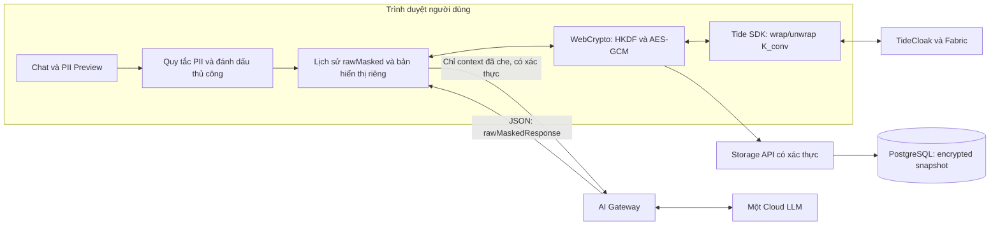

# PLAN v4 — PrivateChat Shield: MVP khả thi và phân công theo độ khó

> Cập nhật: 22/10/2026. Trạng thái: kế hoạch triển khai, chưa phải hệ thống đã được kiểm toán bảo mật.
> Giả định: 4 thành viên, 48 giờ lịch với khoảng 16–20 giờ làm việc tập trung/người. Mốc H0 bắt đầu khi nhóm triển khai; phải đối chiếu với hạn nộp thực tế trước khi bắt đầu. Lộ trình 7–10 ngày là phương án mở rộng nếu thời gian cho phép.
> Phân công đề xuất dựa trên vai trò trước đây: Khoa phụ trách kỹ thuật Tide; Khánh phụ trách tích hợp; Kin phụ trách QA/PII; Hiếu phụ trách giao diện/demo. Ước lượng cần điều chỉnh sau spike đầu tiên, không mặc định mọi thành viên có kinh nghiệm tương đương.

## 1. Mục tiêu và lời hứa sản phẩm

**PrivateChat Shield giúp giảm dữ liệu định danh gửi tới Cloud AI và mã hóa lịch sử trò chuyện trước khi lưu trên server.**

Persona duy nhất của MVP: chuyên viên tín dụng cần soạn bản tóm tắt hồ sơ hoặc danh sách giấy tờ còn thiếu từ dữ liệu khách hàng giả lập. MVP không ra quyết định cho vay và không cần giải bài toán thẩm định tín dụng tự động.

Ba kết quả cần chứng minh:

1. Trình duyệt che những định danh được phát hiện hoặc người dùng chọn trước khi gửi prompt.
2. Database chỉ lưu nội dung hội thoại và bảng ánh xạ PII dưới dạng bản mã; quyền mở khóa được tích hợp thật với TideCloak.
3. Một thay đổi quản trị nằm trong phạm vi QEA không có hiệu lực nếu chưa đủ phê duyệt theo cấu hình thực tế.

**Giới hạn phải nói rõ:** LLM và AI Gateway vẫn nhận được nội dung đã che định danh. Pseudonymisation không bảo mật toàn bộ ý nghĩa câu chat và không bảo đảm chống tái định danh. Nếu yêu cầu là “nhà cung cấp tuyệt đối không nhận nội dung”, tác vụ đó không được gửi qua đường cloud của MVP; local inference/TEE là lộ trình riêng.

Pitch đề xuất:

> “Che dữ liệu định danh trước khi gửi AI. Mã hóa lịch sử trước khi lưu. Dùng TideCloak để kiểm soát mở khóa và quản trị quyền bằng phê duyệt nhiều bên.”

## 2. Chốt phạm vi trước khi chia việc

| Mức | Nội dung | Quyết định |
|---|---|---|
| Must | Đăng nhập Tide thật; wrap/unwrap khóa; kiểm thử hai người dùng; một luồng QEA thật | Điều kiện xác nhận tích hợp Tide thành công |
| Must | Mã hóa phía client bằng WebCrypto; lưu và mở lại hội thoại; phát hiện sửa/tráo ciphertext | Chức năng lưu trữ cốt lõi |
| Must | Che CCCD, SĐT, email, STK bằng quy tắc; tên bằng từ điển/đánh dấu thủ công; preview trước gửi | Chỉ 5 nhóm PII trong MVP |
| Must | Chat nhiều lượt chỉ gửi bản đã che; một provider; output text thuần | Hoàn thành luồng xuyên suốt trước |
| Must | Dữ liệu tổng hợp, kiểm thử quyền truy cập, báo cáo kết quả và video demo | Bằng chứng đi cùng sản phẩm |
| Should | UI so sánh nội dung trước/sau che, copy kết quả, tên hội thoại mã hóa | Làm sau khi Must đã chạy |
| Later | Streaming, fuzzy unmasking, Markdown, NER/ONNX, 12 nhóm PII, Strict Mode nâng cao | Không làm trong bản 48 giờ |
| Later | Anonymous tickets, blind signatures, relay ẩn danh | Gateway MVP có xác thực và biết tài khoản gọi |
| Later | Chống rollback toàn bộ, crypto-shredding chống backup, escrow, Passkey PRF | Cần thiết kế và kiểm chứng riêng |
| Later | Local LLM, GPU TEE, browser extension, chia sẻ hội thoại giữa nhiều người | Không là phụ thuộc của demo đầu tiên |

## 3. Kiến trúc MVP đơn giản



Quyết định kỹ thuật:

- Frontend React + Vite + TypeScript; backend Node.js + TypeScript; PostgreSQL. Chốt một package manager, commit lockfile và pin phiên bản SDK/container sau spike. Không dựng thêm microservice hoặc chuyển framework trong MVP.
- Chỉ dùng một Cloud LLM đã có tài khoản/billing hoạt động. Ghi rõ provider, model ID và chính sách dữ liệu đã kiểm tra trong README. Không dùng Grounding, Files, tools hoặc lưu hội thoại phía provider trong MVP.
- V1 dùng request/response JSON, có timeout và trạng thái thử lại; streaming là nâng cấp sau khi lưu/mở lịch sử ổn định.
- Provider API key chỉ nằm ở backend. Gateway không ghi prompt, response, JWT hoặc PII vào log; kiểm tra cả middleware, error reporting và proxy. Đây là cấu hình vận hành, không phải bảo đảm mật mã đối với Gateway độc hại.
- Hiển thị “Request đã che” lấy từ request thực tế của browser. Nếu kiểm tra payload backend gửi provider, chỉ bật capture tạm thời trong môi trường test với dữ liệu tổng hợp; không tạo kho `lastGatewayEcho` trên server.

## 4. Cổng khả thi TideCloak: làm trước các tính năng nâng cao

Khoa sở hữu spike; Khánh cùng xác minh tích hợp. Dùng tài liệu Tide và SDK thực tế, không suy luận semantics từ tên role.

| Mốc | Phải kiểm tra | Bằng chứng / quyết định |
|---|---|---|
| H0–H2 | Container/license/realm chạy; đăng nhập; `doEncrypt` rồi `doDecrypt` một chuỗi từ browser | Lưu version, cấu hình tái tạo, lỗi và kết quả thực tế |
| H2–H4 | User A bọc khóa; A mở lại được; user B cùng role không mở được ciphertext của A | Ghi kết quả và xác nhận scope user/tag; chưa kết luận an toàn trước khi test |
| H2–H6 | Thay đổi role/chính sách thuộc phạm vi QEA tạo Change Request; chưa đủ approver thì chưa có hiệu lực | Hai danh tính admin độc lập, cấu hình quorum rõ ràng; quay thao tác thật |
| H6 | Chốt tích hợp được hay đang bị chặn | Giảm phạm vi ngay nếu chưa đạt, không phát sinh hệ mật mã fallback |

Phải phân biệt: QEA quản trị thay đổi quyền không đồng nghĩa mỗi lượt chat cần hai người duyệt. Nếu self-encryption cô lập theo user, gán cùng role cho admin cũng không chứng minh admin có thể giải mã dữ liệu của user khác; demo QEA phải giải thích đúng thao tác đang được bảo vệ.

Nếu A/B cùng role mở được dữ liệu của nhau, dừng lưu dữ liệu có tính nhạy cảm và xác minh cơ chế cô lập với tài liệu/sponsor. Không tự chữa bằng PIN, tag động hoặc Passkey chưa kiểm thử trong thời gian còn lại.

Nếu lỗi mạng/license chặn spike:

- Tiếp tục xây UI/PII và hợp đồng storage bằng adapter mock với dữ liệu tổng hợp, gắn nhãn rõ “Mock — chưa chứng minh Tide”. Không bật mock ngầm trong bản trình diễn.
- Khoa ghi blocker và làm việc với hỗ trợ kỹ thuật nếu nhóm tự liên hệ; các thành viên khác tiếp tục phần độc lập.
- Khi đã có tích hợp thật, quay video dự phòng. Nếu đến hạn vẫn chưa tích hợp được, công bố phần chưa hoàn thành; không thay bằng cảnh báo “BLOCKED” giả.

## 5. Thiết kế lưu trữ và mật mã đủ cho MVP

### 5.1. Một encrypted snapshot cho mỗi hội thoại

Để tránh lỗi ghi tin nhắn và PII map lệch nhau, MVP lưu toàn bộ trạng thái hội thoại nhỏ trong một snapshot mã hóa. Không cần bảng `messages` riêng trong bản đầu.

```text
ConversationRow {
  id: UUID,                 // client sinh trước khi dẫn xuất khóa
  owner_id: string,         // backend lấy từ issuer + sub đã xác thực
  wrapped_key: string,      // K_conv được bọc qua Tide
  revision: integer,
  iv: base64,
  encrypted_state: base64,
  schema_version: 1,
  created_at, updated_at
}

DecryptedState {            // chỉ tồn tại ở client
  conversationId, revision, title,
  piiMap,
  turns: [{ turnId, userOriginal, userMasked, assistantRawMasked, status }]
}
```

Metadata như tài khoản sở hữu, thời gian, số hội thoại và kích thước bản mã vẫn lộ cho server. Không dùng thông điệp “DB không có bất kỳ plaintext nào”. MVP giới hạn 20 lượt hoàn chỉnh và 256 KiB bản mã/snapshot; khi vượt giới hạn yêu cầu tạo hội thoại mới. Đây là giới hạn demo, chưa là thiết kế cho lịch sử lớn.

### 5.2. Quy tắc khóa và xác thực bản mã

1. Client sinh `conv_id` bằng UUID và `K_conv` 32 byte bằng CSPRNG. Bọc `K_conv` bằng Tide sau đăng nhập. Khóa bảo vệ của Tide và `K_conv` là hai lớp khác nhau: **K_conv đầy đủ có tồn tại ở client**.
2. Dẫn xuất `DEK_state` bằng HKDF-SHA256, gắn với phiên bản schema, định danh chủ sở hữu và `conv_id`. Dùng WebCrypto AES-256-GCM, IV ngẫu nhiên 12 byte mới mỗi lần mã hóa; không tái sử dụng IV có chủ ý.
3. AAD là một cấu trúc serialize ổn định, ví dụ mảng JSON UTF-8: `[1, "state", ownerId, convId, revision]`. Hai phía thống nhất `ownerId = base64url(SHA-256(UTF8(JSON.stringify([issuer, sub]))))`; issuer/sub lấy từ phiên đã xác thực. Không tin giá trị chủ sở hữu trả về tùy ý từ DB. Sau giải mã kiểm tra ID và revision bên trong snapshot khớp header/ngữ cảnh kỳ vọng.
4. Import khóa với `extractable: false` khi phù hợp; chỉ giữ khóa trong bộ nhớ và bỏ tham chiếu khi logout/đóng hội thoại. Hủy request đang chờ và bỏ callback thuộc phiên cũ để không render/lưu nhầm sau đổi tài khoản. Xóa byte buffer là cố gắng giảm phơi lộ, không hứa xóa mọi bản sao trong JS runtime. Không lưu khóa thô trong localStorage/IndexedDB.
5. Khi cập nhật, gửi `expectedRevision` và snapshot revision kế tiếp. Backend dùng compare-and-swap trong transaction, trả `409` nếu xung đột; UI yêu cầu tải lại thay vì ghi đè âm thầm. Tạo mới dùng ID duy nhất và xử lý retry không tạo bản ghi trùng.
6. Xác thực AES-GCM thất bại thì không hiển thị nội dung hoặc tự khôi phục bằng bản rõ. Ghi mã lỗi kỹ thuật không chứa nội dung.

**Phạm vi bảo đảm:** phát hiện sửa ciphertext và tráo snapshot sang hội thoại/chủ sở hữu khác với ngữ cảnh client kỳ vọng. Không chứng minh freshness khi kẻ tấn công rollback toàn bộ dữ liệu và revision. Compare-and-swap xử lý ghi đồng thời trong hoạt động bình thường, không chống DBA độc hại.

Xóa hội thoại trong MVP là xóa bản ghi ở ứng dụng. Không gọi đó là hủy mật mã chống backup; không thêm escrow, thu hồi từng hội thoại hoặc cam kết thu hồi khóa đã mở trong RAM.

### 5.3. Hợp đồng API tối thiểu

| Endpoint | Request / hành vi | Điều kiện bắt buộc |
|---|---|---|
| `POST /api/conversations` | `{ id, wrappedKey, revision: 1, iv, encryptedState }` | Xác thực JWT, server tự gán owner, giới hạn kích thước |
| `GET /api/conversations` | Danh sách bản ghi thuộc user | Không trả tiêu đề bản rõ |
| `GET /api/conversations/:id` | Một snapshot mã hóa | Kiểm tra quyền sở hữu |
| `PUT /api/conversations/:id` | `{ expectedRevision, revision, iv, encryptedState }` | Owner check, cập nhật atomic, không đổi owner/wrappedKey tùy ý |
| `DELETE /api/conversations/:id` | Xóa bản ghi của user | Owner check; mô tả giới hạn backup |
| `POST /api/chat` | `{ requestId, messages: [{ role, content }] }` đã che | Xác thực, giới hạn role/kích thước/context/output, rate limit và quota |

Backend xác minh JWT theo issuer, audience, chữ ký và thời hạn phù hợp với cấu hình Tide đã chạy thử. Mọi endpoint đều kiểm tra quyền, không chỉ danh sách hội thoại. Không nhận `owner_id` từ body làm nguồn thẩm quyền. Gateway biết tài khoản gọi; `owner_id` đã hash cũng không có nghĩa là ẩn danh.

Không tạo debug/tamper API trong server dùng chung. Demo sửa ciphertext bằng script local trên DB chứa dữ liệu tổng hợp, có bản reset. Rate limit trong RAM chỉ chấp nhận cho một instance demo; triển khai nhiều instance cần bộ đếm chung và kiểm soát chi phí phù hợp.

## 6. PII, chất lượng câu trả lời và dữ liệu nhiều lượt

1. Tự phát hiện CCCD, SĐT, email và STK bằng quy tắc có context. Không dùng bộ kiểm tra “hợp lệ” quá chặt để bỏ qua chuỗi có khả năng là PII; chuỗi nghi ngờ cần được đánh dấu cho người dùng kiểm tra.
2. Tên người trong MVP lấy từ từ điển theo hội thoại hoặc thao tác chọn văn bản. Heuristic tên chỉ là gợi ý nếu còn thời gian; không tự suy ra mọi “anh Hùng” là cùng một người.
3. Preview hiển thị phần đã che và phần sắp gửi. Người dùng có thể che thêm hoặc bỏ lựa chọn. Bấm gửi sử dụng đúng payload bất biến đã preview; nếu sửa đầu vào thì tạo preview mới. Ghi rõ preview không bảo đảm đã tìm đủ PII.
4. Token dùng namespace ngẫu nhiên 128 bit theo hội thoại và ID ổn định, dạng `[[PCS_<namespace>_NAME_1]]`. Chỉ thay thế chính xác token đã phát hành và có trong map. Xử lý trường hợp người dùng nhập sẵn chuỗi giống token; không dùng fuzzy matching hay thay token lồng nhau.
5. Lưu nguyên `assistantRawMasked` từ provider và dựng bản hiển thị bằng khôi phục token ở client. Các lượt sau chỉ gửi `userMasked` và `assistantRawMasked`, tuyệt đối không lấy DOM hoặc bản đã khôi phục để gửi lại. Module dựng request là điểm duy nhất được gọi Gateway và phải có test nhiều lượt.
6. V1 render bằng text node/React escaping; không `dangerouslySetInnerHTML`, Markdown, ảnh hoặc tự tạo hyperlink. Token không khớp giữ nguyên và có thông báo; không đoán giá trị cần thay.
7. Tiền, lãi suất, thời gian và dữ kiện nghiệp vụ chỉ được gửi khi người dùng cho phép. Nếu đánh dấu nhạy cảm nhưng tác vụ cần chúng, yêu cầu sửa prompt hoặc dừng gửi; không tuyên bố model tính đúng khi đầu vào đã bị loại bỏ. Phép tính local là nâng cấp có thể bổ sung sau.
8. Đặt giới hạn context và timeout. Khi provider lỗi, giữ turn ở trạng thái pending/failed để người dùng thử lại; không lưu câu trả lời một phần thành kết quả hoàn chỉnh và không tự retry vô hạn.

## 7. Phân công bốn người theo độ khó

**Độ khó:** Dễ = thao tác rõ, ít phụ thuộc; Vừa = cần code và kiểm thử một module; Khó = tích hợp ngoài/mật mã/quyền truy cập, có thể chặn nhóm. Giờ là ước lượng làm việc tập trung, đã tách khỏi 48 giờ lịch; không phải thời gian cam kết.

**Ưu tiên:** Must phải hoàn thành trước khi tuyên bố tính năng tương ứng hoạt động; Should chỉ bắt đầu khi các Must liên quan đã đạt. Mỗi task có một người chịu trách nhiệm chính; reviewer chỉ xác nhận kết quả, không có nghĩa bắt buộc ghép đôi toàn thời gian.

Các task A1–A5, B1–B5, C1–C5, D1–D3 và D5 là Must; riêng D4 là Should và được cắt đầu tiên khi trễ tiến độ.

### A — Phạm Chấn Khoa: TideCloak, QEA và xác minh bảo mật

Ưu tiên giao cho người quen Docker/OIDC và có khả năng đọc tài liệu SDK. Khánh hỗ trợ ở các điểm tích hợp khó.

| ID | Task | Khó | Giờ | Phụ thuộc | Tiêu chí hoàn thành |
|---|---|---|---|---|---|
| A1 | Dựng Tide, license, realm, login và pin phiên bản | Khó | 2–3 | Tài khoản/license, mạng | Người khác chạy lại được theo hướng dẫn; ghi blocker ở H2 nếu chưa chạy |
| A2 | Adapter wrap/unwrap và test user A/B | Khó | 3–4 | A1 | A mở được sau reload; B không mở được khóa của A; semantics user/tag được ghi lại |
| A3 | Cấu hình và quay một luồng QEA thật | Khó | 3–4 | A1 | Có hai danh tính admin; chứng minh request chưa đủ phê duyệt không có hiệu lực |
| A4 | Hỗ trợ xác minh JWT phía backend và kiểm thử truy cập chéo user | Vừa | 2–3 | A1, B2 | JWT sai/hết hạn bị từ chối; đọc/sửa/xóa conversation của B bị chặn |
| A5 | Rà soát client/log/key lifecycle và viết ghi chú threat model | Vừa | 2–3 | A2, B1, D3 | Không lưu khóa thô; logout bỏ state; danh sách giới hạn khớp hành vi demo |

Tổng: khoảng 12–17 giờ. Reviewer: Khánh. Nếu A1/A2 kẹt, báo ngay để nhóm tiếp tục mock; không dồn sang tự viết hệ quản lý khóa mới.

### B — Lê Gia Khánh: Crypto client, storage API và AI Gateway

Đây là phần có phụ thuộc chéo nhiều nhất; chốt interface sớm và chỉ hỗ trợ UI sau khi đường lưu/mở đã chạy.

| ID | Task | Khó | Giờ | Phụ thuộc | Tiêu chí hoàn thành |
|---|---|---|---|---|---|
| B1 | Envelope crypto phía client: HKDF, AES-GCM, AAD | Khó | 3–4 | Interface A2; mock cho dev | Round-trip đúng; sửa byte/tráo conv/owner bị từ chối; IV mới mỗi lần ghi |
| B2 | Schema snapshot và CRUD API có owner check/CAS | Vừa | 3–4 | Contract chốt H1; A4 hỗ trợ | F5 mở đúng dữ liệu; hai tab ghi xung đột nhận 409; retry không tạo bản trùng |
| B3 | Gateway một provider, JSON response, timeout, quota, không content log | Vừa | 2–3 | API key hoạt động | Chat một lượt được; role/context/output bị giới hạn; lỗi không lộ prompt |
| B4 | Nối A2 + B1 + B2 thành save/load hoàn chỉnh | Khó | 2–3 | A2, B1, B2 | Dữ liệu trong DB mã hóa; A mở lại được; lỗi unwrap không fallback bản rõ |
| B5 | Kiểm tra lỗi provider, cấu hình chạy và reset demo | Vừa | 2–3 | B3, D3 | Dự án chạy theo README, không commit secret; reset chỉ tác động DB demo |

Tổng: khoảng 12–17 giờ. Reviewer: Khoa cho crypto/auth, Kin cho lỗi dữ liệu. B1 là code client dù B sở hữu cả backend; không chuyển plaintext hoặc crypto key sang backend vì thuận tiện.

### C — Cái Hoàng Bảo Kin: PII, kiểm thử và số liệu

Phù hợp vai trò QA có khả năng TypeScript mức vừa. Khánh hỗ trợ chuẩn hóa interface; không yêu cầu C xây model NLP trong 48 giờ.

| ID | Task | Khó | Giờ | Phụ thuộc | Tiêu chí hoàn thành |
|---|---|---|---|---|---|
| C1 | Chuẩn bị 100 câu tổng hợp có nhãn, tách 60 dev/40 holdout | Vừa | 2–3 | Persona và 5 nhóm PII | Có câu có/không dấu, nhập nhằng, câu không PII; không dùng dữ liệu khách hàng thật |
| C2 | Regex/context cho 4 loại số/email và từ điển tên thủ công | Vừa | 3–4 | C1 dev set | Unit test ca biên; không dùng ASCII word boundary như giải pháp tiếng Việt tổng quát |
| C3 | Token map ổn định và khôi phục exact-match | Vừa | 2–3 | Contract D1 | Không thay nhầm tên; literal giống token và token không biết có hành vi xác định |
| C4 | Test nhiều lượt, canary outbound và rò rỉ qua log/DB | Vừa | 3–4 | B3, B4, D3 | Kiểm tra request turn 2/3; bản hiển thị khôi phục không đi vào Gateway |
| C5 | Báo cáo holdout, utility và checklist nghiệm thu | Vừa | 2–3 | C2, C3, luồng chat | Báo số liệu đo được và lỗi còn lại; phân biệt auto-mask với người dùng sửa preview |

Tổng: khoảng 12–17 giờ. Reviewer: Khoa cho kiểm thử bảo mật, Hiếu cho preview/khôi phục. Không chỉnh quy tắc dựa trên holdout rồi vẫn báo đó là kết quả test độc lập.

### D — Trần Trung Hiếu: UI, tích hợp trải nghiệm và trình diễn

Phù hợp vai trò giao diện/demo; bắt đầu bằng component đơn giản, không phụ trách crypto. Nếu ít kinh nghiệm React, Khánh hỗ trợ skeleton và phần state tích hợp; cắt trang trí để giữ thời gian.

| ID | Task | Khó | Giờ | Phụ thuộc | Tiêu chí hoàn thành |
|---|---|---|---|---|---|
| D1 | Chat UI text thuần, preview trước gửi và giao diện hội thoại | Vừa | 3–4 | Contract H1, fixture mock | Dán hồ sơ, thấy phần đã che, sửa lựa chọn và gửi được trên mock |
| D2 | Thao tác chọn văn bản/từ điển tên; nối PII service | Vừa | 2–3 | C2, C3 | Có thể bổ sung tên bị bỏ sót; preview khớp request thực tế |
| D3 | Tích hợp login, request đã che, save/load và lỗi | Khó | 3–4 | A2, B3, B4 | Chat ba lượt, reload đúng, không dựng request từ DOM; pending/409/error rõ ràng |
| D4 | Panel request đã che và bằng chứng DB demo | Dễ | 1–2 | D3, B5 | Hai view không tạo server log chứa nội dung; không cần dashboard riêng |
| D5 | README sử dụng, slide và video demo | Dễ/Vừa | 3–4 | Luồng Must, C5, A3 | Tài liệu đúng giới hạn; video và thời lượng theo yêu cầu chính thức |

Tổng: khoảng 12–17 giờ. Reviewer: Kin cho QA, Khánh cho tích hợp. Video backup và README được ưu tiên trước animation, mobile polish hoặc dashboard ba cột hoàn chỉnh.

## 8. Lộ trình 48 giờ và thứ tự phối hợp

Các mốc là thời gian lịch. Chia ca để mỗi người có thời gian nghỉ; dành phần còn lại cho đồng bộ, chờ dịch vụ và sửa lỗi, không phân công 48 giờ làm việc liên tục.

| Mốc | Mục tiêu chung | Ai làm gì / điều kiện ra cổng |
|---|---|---|
| H0–H1 | Chốt phạm vi và hợp đồng module/API | Khoa chốt Tide adapter; Khánh tạo schema/types; Kin chuẩn bị fixture; Hiếu dựng skeleton |
| H1–H6 | Xác minh rủi ro lớn nhất | A1/A2/A3 spike; B1/B2 bằng mock; C1/C2; D1. H6 công bố trạng thái Tide thật |
| H6–H16 | Có một luồng thật xuyên suốt | Đăng nhập → preview → model → mã hóa snapshot → lưu → reload. Cắt Should nếu chưa đạt |
| H16–H28 | Củng cố và hoàn thiện Must | Chat ba lượt, test A/B, QEA, CRUD authorization, CAS và lỗi provider; sửa ca lỗi trước thêm UI |
| H28–H36 | Đo kiểm và chuẩn bị trình diễn | Holdout, canary, kiểm tra payload/log/DB, đo độ trễ; quay video đầu tiên ngay khi luồng ổn |
| H36–H42 | Feature freeze | Chỉ sửa lỗi chặn demo; hoàn thiện README/slide, kiểm tra chạy trên máy thứ hai |
| H42–H48 | Diễn tập và nộp | Xác minh yêu cầu BTC, quay lại nếu cần, dự phòng mạng và xác nhận hồ sơ nộp |

**Điểm chặn quan trọng:** A2 → B4 → D3. Giảm thời gian chờ bằng interface mock đã thống nhất, không cho phép mock trộn với bản chạy thật mà không có nhãn. D1 và C1/C2 chạy độc lập với Tide.

Nếu H16 chưa có luồng xuyên suốt: bỏ panel mở rộng, chia sẻ hội thoại, đo nhiều tác vụ và mọi Should; tập trung một prompt, một response, save/reload, kiểm thử A/B và QEA. Nếu thời gian thực tế ngắn hơn 48 giờ, chốt lại phạm vi theo cổng này thay vì ép toàn bộ lịch trình.

## 9. Tiêu chí nghiệm thu và số liệu báo cáo

### 9.1. Must-pass trước demo có tuyên bố bảo mật

- [ ] Tích hợp Tide thật có bằng chứng A mở/B bị từ chối; mock không thể bật ngầm.
- [ ] QEA thật: ghi trạng thái trước yêu cầu, pending khi chưa đủ quorum và kết quả sau duyệt/từ chối. Chỉ tuyên bố cho thao tác đã kiểm thử.
- [ ] CRUD không cho user khác đọc/sửa/xóa; JWT sai hoặc hết hạn bị từ chối.
- [ ] Sửa ciphertext/tráo sang conv khác bị xác thực thất bại; không hứa phát hiện rollback đồng bộ toàn DB.
- [ ] Snapshot lưu lại mở đúng sau F5; xung đột hai tab không gây ghi đè âm thầm.
- [ ] Request chat lượt 2/3 chỉ dùng bản đã che; không gửi khóa, PII map hoặc bản hiển thị khôi phục.
- [ ] Không có canary nguyên bản ở payload provider, log và DB dump trong các ca test đã che canary. Ghi rõ cách kiểm tra và phạm vi, không coi grep là chứng minh không rò rỉ mọi dạng.
- [ ] Output được render text thuần, không sinh request ảnh/link; lỗi provider và token không khớp không làm app mất lịch sử.
- [ ] Logout dọn state/khóa của app; trên thiết bị kiểm thử không tìm thấy khóa thô trong storage ứng dụng.
- [ ] Máy thành viên thứ hai chạy được theo README; chỉ dùng dữ liệu tổng hợp trong demo/video.

### 9.2. Chỉ số vừa sức

| Nhóm | Đo thế nào | Cách trình bày |
|---|---|---|
| PII | Precision/recall theo từng loại trên 40 câu holdout; ghi số entity và ca bỏ sót | Tách automatic detection, tên từ điển và sửa thủ công; không tuyên bố 0% ngoài bộ test |
| Leakage | Số câu còn định danh trực tiếp trước/sau preview theo protocol cố định | Nếu người dựng hệ thống tự sửa preview, ghi rõ đây là assisted result |
| Utility | 10 tác vụ tổng hợp: giữ đúng dữ kiện, không nhập nhầm người, checklist giấy tờ hợp lý | Kin chấm theo rubric; không cần LLM-as-Judge trong MVP |
| Độ trễ | Thời gian mask, encrypt, unwrap và toàn bộ request; ít nhất 30 lần nếu đủ thời gian | Báo input/device/network, p50/p95 và số mẫu; chưa đo thì ghi chưa đo |
| Tính sẵn sàng | Tide/LLM mất kết nối, timeout, reload và retry | Ghi hành vi thực tế và giới hạn; không gọi chat cloud là chạy offline |

Không đặt số `<8 ms`, `200–400 ms`, “100% bảo vệ” hoặc “không bao giờ rò rỉ” làm kết quả mặc định. Mục tiêu tối ưu chỉ được chốt sau baseline.

## 10. Nếu có 7–10 ngày

| Giai đoạn | Mở rộng có giá trị | Chủ trì |
|---|---|---|
| Ngày 1–2 | Hoàn thành luồng Must và kiểm thử Tide/QEA | Khoa + Khánh; Kin/Hiếu nối PII/UI |
| Ngày 3–4 | Sửa lỗi tích hợp, mở rộng corpus lên 300 câu với dev/test riêng; utility 30 tác vụ | Kin; Khánh xử lý lỗi dữ liệu |
| Ngày 5–6 | Tối ưu context, latency, UX lỗi và key lifecycle; thêm streaming exact-token nếu thực sự cần | Khánh + Hiếu; Khoa review key/auth |
| Ngày 7 | Feature freeze, kiểm tra máy thứ hai, threat model và video backup | Cả nhóm |
| Ngày 8–10 | Diễn tập, hoàn thiện tài liệu; chỉ sửa lỗi được phát hiện | Hiếu điều phối demo, Khánh chốt phiên bản |

Rollback witness, per-conversation key destruction, TEE, recovery/escrow và ẩn danh mạng vẫn là nghiên cứu tiếp theo; không tự động đưa vào sprint chỉ vì có thêm vài ngày.

## 11. Demo, giới hạn và nguồn tham khảo

Demo ngắn: dán hồ sơ tổng hợp → chọn PII và xem request đã che → nhận câu trả lời với tên được khôi phục tại client → reload lịch sử từ bản mã → thử mở bằng user B/sửa ciphertext → cho thấy một thay đổi quản trị đang chờ QEA. Chọn số bước phù hợp thời lượng BTC, dùng video dự phòng cho phần dài; kiểm tra lại yêu cầu video trước khi xuất, không mặc định 3 phút.

Giới hạn phải có trong README/slide:

- Provider/Gateway vẫn thấy nội dung đã giả danh hóa; quy tắc PII có thể bỏ sót và ngữ cảnh có thể tái định danh.
- Kẻ kiểm soát code frontend có thể chèn code lấy dữ liệu trước mã hóa. CSP/SRI hỗ trợ chống một số kiểu tấn công nhưng không ngăn được chính bên phát hành sửa HTML/chính sách và gửi plaintext tới endpoint được phép. Bản web MVP tin cậy build client đang chạy.
- Mất quyền/mất kết nối Tide có thể khiến không mở được hội thoại mới. Khóa đã unwrap trong RAM không tự biến mất khi IAM thu hồi quyền; người đã đọc được bản rõ có thể giữ bản sao.
- Backup, metadata, full rollback, thiết bị bị chiếm quyền và bảo mật toàn bộ nội dung khi inference trên cloud không được giải quyết đầy đủ bởi MVP.
- Không coi bảng log ứng dụng là immutable hoặc chữ ký giả là bằng chứng mật mã. Không so sánh đối thủ bằng khẳng định chưa có nguồn.

Nguồn để kiểm tra khi triển khai:

1. [Tide E2EE setup](https://docs.tide.org/Admin/e2ee): điều kiện realm/license/QEA, SDK encrypt/decrypt và role. Cần kiểm thử scope A/B trên phiên bản đang dùng.
2. [Tide QEA setup](https://docs.tide.org/Admin/SetupIGA): đối chiếu luồng Change Request, ngưỡng quorum và thao tác được quản trị với cấu hình thực tế; realm chỉ có một admin chưa chứng minh phê duyệt nhiều bên.
3. [Gemini Developer API: Zero data retention](https://ai.google.dev/gemini-api/docs/zdr): “không dùng để huấn luyện” không đồng nghĩa “không lưu dữ liệu”. Gemini Developer API và Vertex AI phải được đánh giá theo dịch vụ/cấu hình cụ thể.
4. [Luật 91/2025/QH15](https://vanban.chinhphu.vn/?classid=1&docid=214590&pageid=27160&typegroup=) và [Nghị định 356/2025/NĐ-CP](https://vanban.chinhphu.vn/?classid=0&docid=216387&pageid=27160): căn cứ hiện hành cần rà soát khi trình bày pháp lý. Nghị định 13/2023 đã hết hiệu lực từ 01/01/2026; chỉ nhắc khi giải thích lịch sử/chuyển tiếp. Không tuyên bố ứng dụng tự động tuân thủ pháp luật hoặc che PII sẽ miễn nghĩa vụ chuyển dữ liệu xuyên biên giới.

**Điều kiện hoàn thành bản kế hoạch:** mỗi thành viên nhận task Must, nhóm chốt hạn nộp thực tế và xác nhận bằng spike rằng Tide, user isolation và QEA chạy được trên môi trường dự định demo.
