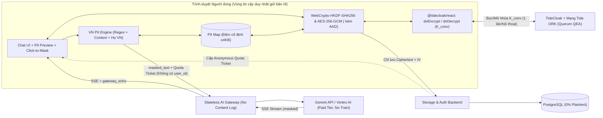

# PLAN (v3 — Bản Chuẩn Hóa Cuối Cùng): PrivateChat Shield — Lớp Bảo Mật & Giả Danh Hóa Cho Chat AI Với TideCloak

> **Trạng thái kiểm duyệt:** Bản v3 đã trải qua **2 vòng kiểm toán đa tác tử (Multi-Agent Review)** gồm:
> 1. **TideCloak Technical Verifier:** Kiểm chứng SDK `@tidecloak/react`, cơ chế tag `_tide_<tag>.selfencrypt` / `.selfdecrypt`, và Quorum-Enforced Governance (QEA / Change Requests).
> 2. **Cryptographic & Systems Security Auditor:** Kiểm toán mật mã phong bì (Envelope Encryption), HKDF-SHA256, AES-GCM Additional Authenticated Data (AAD), chống tráo bản mã/đảo thứ tự/rollback, Dual-Track History, Anonymous Gateway Tickets, và chống Markdown Exfiltration.
> 3. **VN PII, NLP & Legal Compliance Specialist:** Xác minh điều khoản **Luật Bảo vệ dữ liệu cá nhân số 91/2025/QH15** (hiệu lực 01/01/2026) & **Nghị định 13/2023/NĐ-CP**, thiết kế bộ lọc PII tiếng Việt 3 tầng (có dấu & không dấu) và máy trạng thái `StreamingFuzzyUnmasker`.
> 4. **RMIT Hackathon Head Judge & Mentor:** Chuẩn hóa SQL Schema, TypeScript Contracts, REST/SSE API, kịch bản Fallback Giờ thứ 6 giữ nguyên 3 trụ cột, checklist DoD từng ngày (10 ngày & 48 giờ), và Top 10 câu hỏi phản biện Giám khảo (Judge Q&A).

---

## 1. Bài toán & Căn cứ Thực tiễn / Pháp lý

### 1.1. Nỗi đau thực tế (The Problem)
Nhân viên ngân hàng, bệnh viện, công ty luật và doanh nghiệp tại Việt Nam hàng ngày dán trực tiếp dữ liệu nhạy cảm (hồ sơ vay vốn, CCCD, sao kê STK, bệnh án, hợp đồng M&A) vào các AI public (ChatGPT, Gemini, Claude) hoặc AI Portal nội bộ.
Khi đó, dữ liệu đối mặt với **2 điểm lộ lọt chí mạng**:
1. **Trên đường lên Cloud LLM (Data-in-Use / Cross-Border):** Nhà cung cấp LLM ngoại quốc thấy toàn bộ định danh cá nhân (PII) dạng bản rõ.
2. **Tại máy chủ lưu trữ lịch sử chat (Data-at-Rest / Insider Threat):** Nhà phát triển ứng dụng, quản trị viên cơ sở dữ liệu (DBA), Root Admin hoặc hacker tấn công DB có thể đọc trọn bộ lịch sử hội thoại và tự ý nâng quyền truy cập.

### 1.2. Căn cứ Pháp lý Việt Nam (Đã kiểm chứng chính xác 100%)
- **Luật Bảo vệ dữ liệu cá nhân số 91/2025/QH15** *(Quốc hội khóa XV thông qua ngày 26/06/2025, **có hiệu lực từ ngày 01/01/2026**)*:
  - **Khoản 1 Điều 30 (Xử lý DLCN trong AI & Cloud):** *"Dữ liệu cá nhân trong môi trường dữ liệu lớn, **trí tuệ nhân tạo**, chuỗi khối, vũ trụ ảo và **điện toán đám mây** phải được xử lý đúng mục đích và **giới hạn trong phạm vi cần thiết**..."*
  - **Điều 20 & Điều 21 (Chuyển DLCN xuyên biên giới):** Sử dụng nền tảng đặt ngoài lãnh thổ Việt Nam để xử lý DLCN thu thập tại Việt Nam cấu thành hành vi chuyển DLCN xuyên biên giới, bắt buộc lập Hồ sơ đánh giá tác động gửi cơ quan chuyên trách (Cục A05 - Bộ Công an) trong 60 ngày; vi phạm có thể bị phạt tới **5% tổng doanh thu năm trước tại Việt Nam** hoặc tối đa **3 tỷ đồng**.
  - **Khoản 1 Điều 2 & Điều 14:** Quy định về **khử nhận dạng dữ liệu cá nhân**.
- **Nghị định 13/2023/NĐ-CP** *(Hiệu lực 01/07/2023)*:
  - **Khoản 4 Điều 2:** Xếp thông tin **hồ sơ bệnh án** (Điểm c) và **thông tin định danh, tài khoản, tiền gửi, giao dịch của khách hàng tổ chức tín dụng/ngân hàng** (Điểm g) vào nhóm **Dữ liệu cá nhân nhạy cảm**.
  - **Điều 24 & Điều 25:** Yêu cầu Hồ sơ đánh giá tác động xử lý DLCN (DPIA) và chuyển DLCN ra nước ngoài.

---

## 2. Giải pháp: 3 Trụ cột Bảo mật ("PrivateChat Shield")

1. **Trụ cột 1 — Mã hóa Phong bì Phía Client, Khóa Bảo vệ Ngưỡng (Threshold-Protected Client-Side Envelope Encryption):**
   - Mỗi hội thoại được mã hóa ngay trên trình duyệt bằng khóa AES-256-GCM dẫn xuất từ khóa gốc hội thoại `K_conv`.
   - Chỉ duy nhất `K_conv` được bọc (wrap) qua mạng lưới node phi tập trung (ORK) của **TideCloak** bằng mật mã ngưỡng (*Ineffable Cryptography*). Không một bên nào — kể cả nhóm phát triển, Cloud Provider hay Tide — giữ khóa đầy đủ.
2. **Trụ cột 2 — Quản trị Đa chữ ký, Xóa sổ "God Admin" (Quorum-Enforced Governance / QEA):**
   - Mọi thao tác nhạy cảm của Admin (như tự cấp role giải mã kho dữ liệu chung, thay đổi chính sách bảo mật) đều bị chặn lại thành **Change Request** và bắt buộc phải có chữ ký số phê duyệt của **Quorum các Admin độc lập**.
   - **Đây là vũ khí khác biệt độc nhất** của sản phẩm so với các công cụ che PII thông thường.
3. **Trụ cột 3 — Giả danh hóa PII Tiếng Việt Chuyên sâu Trước Khi Gửi LLM (Client-Side VN Pseudonymisation):**
   - Pipeline 3 tầng chạy 100% trên trình duyệt phát hiện và thay thế 12 nhóm thực thể nhạy cảm Việt Nam (`[NAME_1]`, `[CCCD_1]`, `[STK_1]`...) trước khi gửi qua AI Gateway. Khi LLM stream câu trả lời về, máy trạng thái trên trình duyệt tự động ghép lại giá trị thật theo thời gian thực.

**Headline Pitch:**
> *"Không ai — kể cả DBA, Root Admin hay chính chúng tôi — đọc được lịch sử chat AI của bạn. Còn AI trên Cloud thì giải quyết bài toán của bạn mà không hề biết bạn là ai."*

---

## 3. Quy tắc Ngôn từ Khi Pitch (BẮT BUỘC Tuân Thủ)

| ✅ ĐƯỢC NÓI (Chính xác về mật mã & pháp lý) | ❌ KHÔNG ĐƯỢC NÓI (Sai bản chất / Giám khảo bắt bẻ) |
|---|---|
| *"Role-gated, threshold-protected client-side envelope encryption"* | *"E2EE giống hệt Signal"* hoặc *"Hoàn toàn trustless"* |
| *"Server, DB và Admin đơn lẻ không đọc được lịch sử chat; thay đổi quyền bắt buộc qua Quorum"* | *"Không ai trên đời có thể tấn công được client"* |
| *"LLM chỉ nhận prompt đã giả danh hóa; loại bỏ định danh trực tiếp với Recall X% trên bộ test tiếng Việt"* | *"AI hoàn toàn không thấy bất kỳ thông tin gì"* |
| *"Thực thi kỹ thuật cho nguyên tắc tối thiểu hóa dữ liệu trong AI tại Khoản 1 Điều 30 Luật BVDLCN 91/2025/QH15 và hỗ trợ hồ sơ Điều 20, 21 (Luật 91) & Điều 24, 25 (NĐ 13)"* | *"Dùng app này là tự động tuân thủ 100% Luật BVDLCN / miễn trừ hoàn toàn thủ tục chuyển dữ liệu xuyên biên giới"* |
| *"Thu hẹp niềm tin vào nhà vận hành về mã nguồn client có thể kiểm toán (auditable client code + CSP/SRI)"* | *"Server độc hại sửa code JS cũng không sao"* |

---

## 4. Kiến trúc Hệ thống & Thiết kế Mật mã Chuẩn Hóa



### 4.1. Thiết kế Mật mã Phong bì Chống Giả mạo (Authenticated Envelope Encryption)
1. **Khóa gốc hội thoại (`K_conv`) & Dẫn xuất khóa con bằng HKDF-SHA256:**
   - Khi tạo hội thoại mới, trình duyệt sinh ngẫu nhiên `K_conv` (32 bytes CSPRNG), gọi `doEncrypt([{ data: base64(K_conv), tags: ["chat"] }])` của TideCloak một lần duy nhất để lấy `wrapped_dek` lưu vào bảng `conversations`.
   - Khi mở hội thoại, trình duyệt gọi `doDecrypt` lấy lại `K_conv`, nạp ngay vào WebCrypto `HKDF` với thuộc tính **`extractable: false`** và xóa trắng mảng byte gốc trong RAM (`kConvBytes.fill(0)`).
   - Từ `K_conv`, trình duyệt dẫn xuất 2 khóa con gắn chặt với `owner_sub_hash` và `conv_id`:
     - `DEK_msg = HKDF-SHA256(K_conv, salt=conv_id, info="v1|msg_dek|" + owner_sub_hash + "|" + conv_id)`
     - `DEK_map = HKDF-SHA256(K_conv, salt=conv_id, info="v1|map_dek|" + owner_sub_hash + "|" + conv_id)`
   - **Tác dụng:** Nếu DBA độc hại tráo `wrapped_dek` từ Hội thoại A sang Hội thoại B, khóa dẫn xuất sẽ khác nhau và AES-GCM báo lỗi xác thực ngay lập tức.
2. **Gắn kết ngữ cảnh bằng AES-GCM Additional Authenticated Data (AAD):**
   - Mọi tin nhắn khi mã hóa bằng `DEK_msg` đều truyền `additionalData` (AAD):
     $$\text{AAD}_{\text{msg}} = \text{UTF8}(\text{"v1|msg|"} \parallel \text{owner\_sub\_hash} \parallel \text{"|"} \parallel \text{conv\_id} \parallel \text{"|"} \parallel \text{msg\_index} \parallel \text{"|"} \parallel \text{role})$$
   - Mọi bản cập nhật metadata/PII Map khi mã hóa bằng `DEK_map` đều truyền AAD:
     $$\text{AAD}_{\text{meta}} = \text{UTF8}(\text{"v1|meta|"} \parallel \text{owner\_sub\_hash} \parallel \text{"|"} \parallel \text{conv\_id} \parallel \text{"|"} \parallel \text{meta\_version})$$
     Bên trong JSON của `encrypted_meta` lưu kèm `last_msg_index` để phát hiện nếu DBA xóa bớt tin nhắn cuối (Truncation Attack) hoặc quay lui phiên bản Map (Rollback Attack).
3. **Đệm kích thước theo bậc cố định (Fixed-Bucket Padding) & IV Duy nhất:**
   - Mỗi lần mã hóa đều sinh mới `iv = crypto.getRandomValues(new Uint8Array(12))` (96-bit).
   - Trước khi đưa vào AES-GCM, chuỗi JSON của tin nhắn được đệm vào trường `_pad` để tổng độ dài byte UTF-8 khớp đúng các bậc `512B, 2048B, 8192B, 32768B`.
   - Riêng `encrypted_meta` (chứa `title` và `piiMap`) luôn được đệm tối thiểu **4096 bytes** (bậc kế tiếp `16384B`) để DB/Admin không thể đoán số lượng thực thể PII dựa trên độ tăng kích thước byte.
4. **Dual-Track History (Chống rò rỉ PII ở lượt chat thứ 2):**
   - Bản ghi tin nhắn giải mã ở client giữ song song `{ plaintext, maskedText, spans }`.
   - Khi gửi ngữ cảnh hội thoại nhiều lượt (multi-turn context) lên AI Gateway ở lượt thứ 2, thứ 3..., trình duyệt **CHỈ ĐƯỢC lấy trường `maskedText`**, tuyệt đối không bao giờ đọc `plaintext` để gửi đi hay chạy hàm mask lại trên câu trả lời của LLM.
5. **Crypto-Shredding 2 Cấp độ ("Quyền được xóa" thực chất):**
   - *Cấp độ 1 (Tức thời trên App):* Xóa `wrapped_dek = NULL` trong bảng `conversations` khiến mọi bản ghi `messages` trở thành vô nghĩa.
   - *Cấp độ 2 (Chống lại cả bản DB Backup đã bị hacker lấy cắp trước đó):* Thu hồi quyền/khóa giải mã của tag trên TideCloak thông qua Quorum — mạng lưới Tide ORK sẽ từ chối lệnh `doDecrypt` đối với cả các `wrapped_dek` nằm trong bản sao lưu cũ của kẻ tấn công.

### 4.2. Tách rời Danh tính tại AI Gateway (Anonymous Quota Tickets)
- Để AI Gateway không bị bot gọi chùa làm cháy quota Gemini nhưng cũng **không biết `user_id` nào đang gửi prompt đã che**:
  1. Khi vào phiên chat, trình duyệt gọi Auth Backend (`POST /api/quota/tickets` kèm TideCloak JWT) để lấy 1 lô 10 **Anonymous Ticket** có chữ ký HMAC/Ed25519 của server: `{ ticketId: uuid, exp: timestamp, maxTokens: 4096 }` (hoàn toàn không chứa `sub` hay `email`).
  2. Khi gọi `POST /api/gateway/chat`, trình duyệt chỉ gửi header `X-Gateway-Ticket: <signed_ticket>` (dùng 1 lần). Gateway kiểm tra chữ ký + chống replay `ticketId` trên RAM rồi gọi Gemini.
  3. Nhờ vậy, ngay cả khi ai đó đứng trên AI Gateway, họ chỉ thấy một prompt đã che PII đi kèm một mã vé ẩn danh.

### 4.3. Xử lý Scope Tag của TideCloak & Kịch bản Quorum
- **Kiểm chứng trong Giờ 1–3 Ngày 1:** Kiểm tra xem role `_tide_chat.selfdecrypt` trên TideCloak gắn khóa theo từng cá nhân (`sub`) hay theo nhóm có chung role:
  - **Nhánh A (Khóa cô lập theo từng User):** Dữ liệu cá nhân mặc định an toàn trước các user khác và Admin. Để demo **Quorum chống God Admin** ở Mục 11, tạo thêm một kho **"Hồ sơ Tín dụng Dùng chung của Chi nhánh"** gắn với shared role `_tide_branch_vip.decrypt`. Khi Admin độc hại tự cấp role `_tide_branch_vip.decrypt` cho mình để đọc hồ sơ VIP, hệ thống TideCloak QEA sẽ treo thành **Change Request** chờ các Admin khác ký duyệt!
  - **Nhánh B (Khóa gắn theo Role Tag):** Bắt buộc dùng dynamic tag theo từng user (`_tide_u_<sub_hash>.selfencrypt`) kết hợp bọc HKDF với khóa lưu trên thiết bị (WebAuthn PRF / PIN). Khi Admin tự cấp role `_tide_u_<victim_hash>.selfdecrypt` cho mình, lệnh đó bị chặn bởi **Change Request Quorum**.

---

## 5. Mô hình Đe dọa Trung thực (Threat Model — Trình bày 1 Slide)

| Mối đe dọa / Kẻ tấn công | Trạng thái | Cơ chế bảo vệ hoặc Giới hạn thực tế |
|---|---|---|
| **1. Lộ toàn bộ DB (SQL Injection / Backup Leak)** | ✅ **Bảo vệ tuyệt đối** | DB chỉ chứa AES-256-GCM ciphertext; `wrapped_dek` cần mạng Tide ORK; thu hồi quyền trên Tide vô hiệu hóa cả bản backup cũ. |
| **2. DBA độc hại tráo bản mã / đảo thứ tự / xóa tin nhắn cuối** | ✅ **Phát hiện & Chặn 100%** | HKDF gắn `conv_id` + AES-GCM `additionalData` (AAD) gắn `msg_index`, `role` + kiểm tra `last_msg_index` trong `encrypted_meta`. |
| **3. "God Admin" tự cấp quyền giải mã trên IAM** | ✅ **Chặn bởi Quorum** | TideCloak QEA bắt buộc Change Request phải đủ chữ ký số từ Quorum các Admin độc lập. |
| **4. Nhà cung cấp Cloud LLM thấy định danh trực tiếp (PII)** | ✅ **Đã che trên trình duyệt** | 12 nhóm PII Việt Nam bị thay bằng `[LOẠI_SỐ]` trước khi rời trình duyệt; lịch sử đa lượt dùng Dual-Track (`maskedText`). |
| **5. AI Gateway liên kết danh tính người dùng với nội dung chat** | ✅ **Đã tách rời** | Xác thực qua `Anonymous Quota Ticket` dùng 1 lần, không chứa `user_id`/`email`. (Lưu ý: Tầng TCP vẫn thấy IP nếu không qua relay). |
| **6. Prompt Injection sinh ảnh/link Markdown làm rò rỉ PII sau khi ghép** | ✅ **Đã khóa 3 lớp** | Cấm `unmask()` trong thuộc tính URL (`href`/`src`); vô hiệu hóa thẻ `` trong Markdown; khóa CSP `img-src 'self' data:`. |
| **7. Tái định danh qua ngữ cảnh (Quasi-identifiers: chức vụ, vụ việc đặc thù)** | ⚠️ **Giảm thiểu một phần** | Chế độ **Strict Mode** khái quát hóa thêm `ORG`, `MONEY`, `DATE`, `ADDR` + chấm điểm rủi ro (`riskScore`) + người dùng bôi đen thêm. |
| **8. Nhà vận hành phát hành bản build JS độc hại / XSS trên trình duyệt** | ⚠️ **Giới hạn cố hữu của Web** | Giảm thiểu bằng CSP chặt (`connect-src` allowlist), Subresource Integrity (SRI), Public Build Hash, và đóng gói Browser Extension ghim phiên bản ở v2. |
| **9. Máy trạm của người dùng bị cài mã độc / keylogger** | ❌ **Ngoài phạm vi** | Không hệ thống mã hóa đầu-cuối nào bảo vệ được nếu thiết bị đầu cuối hiển thị bản rõ đã bị chiếm quyền điều khiển. |

---

## 6. Đặc tả Kỹ thuật Nhận diện & Giả danh hóa PII Tiếng Việt (100% In-Browser TypeScript)

### 6.1. Thứ tự Ưu tiên & Quy tắc Chống Đè Nhãn (Non-Overlapping Span Merge)
Pipeline quét văn bản theo thứ tự độ đặc thù giảm dần và hợp nhất các span không chồng lấn (ưu tiên span có độ tin cậy cao hơn hoặc dài hơn):
`USER_DICT` $\rightarrow$ `EMAIL` $\rightarrow$ `CCCD` $\rightarrow$ `PHONE` $\rightarrow$ `TAX_ID (MST)` $\rightarrow$ `LICENSE_PLATE` $\rightarrow$ `STK` $\rightarrow$ `CMND` $\rightarrow$ `DATE` $\rightarrow$ `MONEY` $\rightarrow$ `ADDR` $\rightarrow$ `NAME` $\rightarrow$ `ORG`.

### 6.2. Bộ Regex & Hàm Kiểm chứng Cấu trúc Việt Nam (Copy-Paste Ready)
```typescript
// 1. CCCD 12 số: Kiểm tra đúng 63 mã tỉnh Việt Nam (001-096) + mã thế kỷ/giới tính
const VALID_CCCD_PROVINCES = new Set([
  '001','002','004','006','008','010','011','012','014','015','017','019','020','022','024','025','026','027',
  '030','031','033','034','035','036','037','038','040','042','044','045','046','048','049','051','052','054',
  '056','058','060','062','064','066','067','068','070','072','074','075','077','079','080','082','083','084',
  '086','087','089','091','092','093','094','095','096'
]);
export const CCCD_REGEX = /(?<!\d)(0\d{2})[\s.]?([0-9]\d{2})[\s.]?(\d{3})[\s.]?(\d{3})(?!\d)/g;

export function isValidCCCD(match: RegExpExecArray, fullText: string): boolean {
  const digits = match[0].replace(/[\s.]/g, '');
  if (digits.length !== 12) return false;
  const province = digits.slice(0, 3);
  const genderCentury = Number(digits[3]);
  const hasCtx = /(?:cccd|căn cước|định danh|cmnd|số thẻ)/i.test(
    fullText.slice(Math.max(0, match.index - 35), match.index)
  );
  return (VALID_CCCD_PROVINCES.has(province) && genderCentury <= 3) || (hasCtx && genderCentury <= 9);
}

// 2. Số điện thoại Việt Nam (Di động 03,05,07,08,09 & Cố định 02x, hỗ trợ +84 và dấu chấm/gạch/cách)
export const VN_PHONE_REGEX = /(?<!\d)(?:(?:\+?84|\(\+?84\))[\s.-]?|0)(?:(?:3[2-9]|5[25689]|7[06-9]|8[1-9]|9[0-46-9])(?:[\s.-]?\d){7}|2\d{1,2}(?:[\s.-]?\d){7,8})(?!\d)/g;

// 3. Số tài khoản Ngân hàng (6-19 số) + Thẻ Napas (9704...) kèm Context Window ±55 ký tự
export const NAPAS_CARD_REGEX = /(?<!\d)9704(?:[\s.-]?\d{4}){3}(?!\d)/g;
export const BANK_CTX_KEYWORDS = /\b(?:stk|số tài khoản|so tai khoan|số tk|so tk|tài khoản|tai khoan|chuyển khoản|chuyen khoan|thụ hưởng|thu huong|vietcombank|vcb|techcombank|tcb|mbbank|\bmb\b|bidv|vietinbank|ctg|agribank|vpbank|tpbank|acb|sacombank|stb|hdbank|vib|shb|seabank|msb|ocb|lpbank|eximbank|momo|zalopay)\b/i;

// 4. Mã số thuế (10 số kèm context hoặc 13 số dạng XXXXXXXXXX-XXX)
export const MST_13_REGEX = /(?<!\d)(0[1-9]|[1-8]\d|9[0-6])\d{8}-\d{3}(?!\d)/g;
export const MST_10_CTX_REGEX = /(?:\b(?:mst|mã số thuế|ma so thue|tax(?:\s*code|\s*id)?)\b[\s:.-]{0,15})((?:0[1-9]|[1-8]\d|9[0-6])\d{8})(?!\d)/gi;

// 5. Biển số xe, Email, Ngày tháng, Số tiền, Địa chỉ phân cấp Việt Nam
export const VN_PLATE_REGEX = /\b([1-9]\d)[\s-]?([A-Z]{1,2}\d?|[A-Z]\d)[\s-]?(\d{3}\.\d{2}|\d{4,5})\b/g;
export const EMAIL_REGEX = /\b[A-Za-z0-9._%+-]+@[A-Za-z0-9.-]+\.[A-Za-z]{2,}\b/g;
export const VN_DATE_REGEX = /\b(?:(?:ngày|ngay)\s+)?(0?[1-9]|[12]\d|3[01])(?:\s*[\/.-]\s*|\s+(?:tháng|thang)\s+)(0?[1-9]|1[0-2])(?:(?:\s*[\/.-]\s*|\s+(?:năm|nam)\s+)((?:19|20)\d{2}))?\b/gi;
export const VN_MONEY_REGEX = /(?<!\w)(?:(\d{1,3}(?:[.,]\d{3})+|\d+(?:[.,]\d+)?)\s*(tỷ|tỉ|ty|ti|triệu|trieu|tr|nghìn|nghin|ngàn|ngan|k|đồng|dong|vnđ|vnd|đ|usd|\$)(?:\s*(?:đồng|dong|vnđ|vnd|rưỡi|ruoi|\d{1,2}\b))?)(?!\w)/gi;
export const VN_ADDR_REGEX = /\b(?:(?:số|so|nhà|nha|lô|lo|căn hộ|can ho)\s+\d+[A-Za-z0-9\/.-]*[\s,]+)?(?:(?:ngõ|ngo|ngách|ngach|hẻm|hem|kiệt|kiet|đường|duong|phố|pho|ấp|ap|thôn|thon|khu phố|kp|tổ|to)\s+[A-Za-zÀ-ỹ0-9\/.\s]{1,35}?[\s,]+)+(?:(?:phường|phuong|p\.|xã|xa|x\.|thị trấn|tt\.|quận|quan|q\.|huyện|huyen|h\.|thành phố|tp\.|tỉnh|tinh)\s+[A-Za-zÀ-ỹ0-9\s]{1,30}(?:[\s,]+(?:quận|quan|q\.|huyện|huyen|h\.|thành phố|tp\.|tỉnh|tinh)\s+[A-Za-zÀ-ỹ0-9\s]{1,30})*)/gi;
```

### 6.3. Nhận diện Tên Người Tiếng Việt 3 Tầng (Bắt cả Có dấu & Không dấu / Viết thường)
1. **Tầng 1 (User Dictionary & Session Alias Propagation):** Khi bắt được tên đầy đủ `"Nguyễn Văn Hùng"` ở đầu hội thoại, tự động sinh các biến thể rút gọn (`"Văn Hùng"`, `"anh Hùng"`, `"nguyen van hung"`, `"anh hung"`) vào bảng tra của phiên để các câu sau gõ tắt vẫn ánh xạ về đúng `[NAME_1]`.
2. **Tầng 2 (Heuristic 60 Họ phổ biến + Tên đệm + Danh xưng ngữ cảnh):**
   - Bắt cụm 2–4 âm tiết viết hoa chữ cái đầu (`Nguyễn Văn A`, `Tran Thi Mai`) bắt đầu bằng 1 trong 60 họ phổ biến Việt Nam (`nguyễn, trần, lê, phạm, hoàng, huỳnh, phan, vũ, võ, đặng, bùi, đỗ, hồ, ngô, dương, lý...`).
   - Bắt cả cụm **viết thường không dấu** (`anh nguyen van an`, `khach hang le thi hoa`) khi đứng sau danh xưng (`anh, chị, ông, bà, em, khách hàng, bệnh nhân, chủ tài khoản, người vay, tên là...`) hoặc khớp cấu trúc `[Họ VN] + [Đệm phổ biến: van/thi/huu/duc/minh/ngoc/thanh/quoc/gia/xuan] + [Tên]` và không thuộc danh sách từ ghép thông thường (`nguyen van ban`, `ly do`, `van ban`, `hoang mang`, `ha noi`, `ho chi minh`...).
3. **Tầng 3 (Tùy chọn Lazy-load WebWorker ONNX NER):** Chạy ngầm `@huggingface/transformers` trong WebWorker (cache IndexedDB) nếu người dùng bật chế độ AI Deep Scan.

### 6.4. Ghép lại Token Khi Streaming (Accumulated Prefix + Single-Pass Fuzzy Unmasker)
- **System Prompt bắt buộc gắn ở Gateway:** Yêu cầu LLM giữ nguyên tuyệt đối định dạng `[LOẠI_SỐ]`, không dịch, không bỏ ngoặc, và không bao giờ nhúng token vào URL/Markdown image.
- **Thuật toán chống cắt đôi chunk (`[NA` + `ME_1]`) và chống lỗi `NAME 1` vs `NAME 12`:**
  - Giữ bộ đệm `rawMaskedStream` nguyên bản trong RAM. Mỗi khi nhận chunk SSE mới, cắt riêng phần đuôi ở cuối chuỗi nếu đang mở dở ngoặc `[` hoặc đang gõ dở tiền tố token (`/(\[[^\]]{0,24}|(?:NAME|PHONE|CCCD|CMND|STK|EMAIL|ADDR|TAX_ID|LICENSE_PLATE|ORG|MONEY|DATE)[_\s-]*\d*)$/i`).
  - Quét **1 lượt duy nhất (Single-Pass Regex Tokenizer)** trên phần tiền tố đã hoàn chỉnh để thay thế mọi token (kể cả biến thể bị LLM làm lệch như `[Name_1]`, `(NAME_1)`, `NAME_1`) bằng giá trị thật trong `piiMap`, **nhưng bỏ qua không thay thế nếu token nằm trong thuộc tính URL (`http://`, `https://`, `href=`, `src=`)**.

---

## 7. Đặc tả Database, API & Hợp đồng Code (Sẵn sàng Code Ngay Sáng Ngày 1)

### 7.1. Schema PostgreSQL (`schema.sql` — Người B khởi tạo trong 5 phút)
```sql
CREATE TABLE conversations (
  id UUID PRIMARY KEY DEFAULT gen_random_uuid(),
  owner_sub_hash TEXT NOT NULL,          -- SHA-256(jwt.sub)
  wrapped_dek TEXT,                      -- Base64 K_conv bọc qua TideCloak doEncrypt (NULL nếu đã crypto-shred)
  meta_version INT NOT NULL DEFAULT 1,   -- Đưa vào AAD_meta để chống rollback PII Map
  meta_iv TEXT NOT NULL,                 -- 12-byte random IV (Base64), sinh mới mỗi lần cập nhật
  encrypted_meta TEXT NOT NULL,          -- AES-256-GCM(DEK_map, padded_4KB({ title, piiMap, lastMsgIndex, strictMode }), AAD_meta)
  is_shredded BOOLEAN DEFAULT FALSE,
  created_at TIMESTAMPTZ DEFAULT NOW(),
  updated_at TIMESTAMPTZ DEFAULT NOW()
);

CREATE TABLE messages (
  id UUID PRIMARY KEY DEFAULT gen_random_uuid(),
  conv_id UUID NOT NULL REFERENCES conversations(id) ON DELETE CASCADE,
  msg_index INT NOT NULL,                -- Thứ tự 0, 1, 2... đưa vào AAD_msg chống đảo thứ tự/cắt cụt
  role TEXT NOT NULL CHECK (role IN ('user', 'assistant')),
  iv TEXT NOT NULL,                      -- 12-byte random IV (Base64)
  ciphertext TEXT NOT NULL,              -- AES-256-GCM(DEK_msg, padded_bucket({ plaintext, maskedText, spans }), AAD_msg)
  created_at TIMESTAMPTZ DEFAULT NOW(),
  UNIQUE(conv_id, msg_index)
);
```

### 7.2. Hợp đồng REST & SSE API (`Người B ↔ Người D`)
| Method & Endpoint | Request | Response | Ghi chú bảo mật |
|---|---|---|---|
| `POST /api/quota/tickets` | Header `Authorization: Bearer <tide_jwt>` | `{ tickets: Array<{ ticketId, exp, sig }> }` | Cấp vé ẩn danh để gọi Gateway không lộ `sub` |
| `POST /api/conversations` | `{ wrappedDek, metaVersion, metaIv, encryptedMeta }` | `{ id, createdAt }` | DB chỉ lưu Base64 ciphertext |
| `GET /api/conversations` | — | `Array<ConversationRow>` | Lọc theo `owner_sub_hash` |
| `PATCH /api/conversations/:id` | `{ metaVersion, metaIv, encryptedMeta }` | `{ ok: true }` | Cập nhật `piiMap` mới (IV mới + `metaVersion + 1`) |
| `DELETE /api/conversations/:id/shred` | — | `{ shredded: true, wipedDek: true }` | **Crypto-shredding**: xóa `wrapped_dek = NULL` |
| `GET /api/conversations/:id/messages` | — | `Array<MessageRow>` | Client kiểm tra chuỗi `msg_index` liên tục `0..lastMsgIndex` |
| `POST /api/conversations/:id/messages` | `{ msgIndex, role, iv, ciphertext }` | `{ id, createdAt }` | Lưu bản mã tin nhắn |
| `POST /api/gateway/chat` (SSE) | Header `X-Gateway-Ticket` + Body `{ messages: [{role, content: maskedText}] }` | SSE: `event: gateway_echo` (hiển thị ở Cột 2), `event: token`, `event: done` | Stateless, 0 content log, chỉ nhận `maskedText` |
| `GET /api/debug/inspector?convId=...` | `convId` | `{ pgConvRow, pgMsgRows, lastGatewayEcho }` | Dữ liệu thật 100% cho **Cột 3** (Live DB Inspector) |
| `POST /api/debug/tamper` | `{ convId, msgId, action: 'swap_ct' \| 'flip_role' }` | `{ tampered: true }` | Phục vụ nút Demo **"Giả lập DBA Độc hại Sửa DB"** |

---

## 8. Cổng Go/No-Go Giờ thứ 6 & Phương án Dự phòng Giữ Nguyên 3 Trụ Cột

Tại **Giờ thứ 6 của Ngày 1**, Người A đánh giá 4 tiêu chí với TideCloak Docker:
1. Container `tideorg/tidecloak-dev:latest` chạy ổn định và kích hoạt được license dev.
2. `doEncrypt` / `doDecrypt` bọc/mở khóa được `K_conv` từ trình duyệt trong `< 1500ms`.
3. Xác minh rõ cơ chế scope của tag (để chọn Nhánh A hoặc Nhánh B ở Mục 4.3).
4. Tạo được Change Request yêu cầu Quorum ≥ 2 Admin duyệt.

> [!IMPORTANT]
> **Nếu TideCloak gặp sự cố mạng hoặc license sau 6 giờ:**
> Chuyển biến môi trường sang `NEXT_PUBLIC_CRYPTO_MODE=fallback` (**Shamir Split-Key + WebCrypto Ed25519 Quorum**), **KHÔNG bỏ bất kỳ trụ cột nào**:
> 1. **Giữ Trụ cột 1 (Chia mảnh khóa):** Dùng **Shamir's Secret Sharing (2-of-2)** trên trình duyệt tách khóa bọc `KEK` thành `Share_1` (lưu trong WebAuthn Passkey PRF / thiết bị người dùng) và `Share_2` (lưu trên Key-Share Microservice độc lập với Postgres). DBA chiếm Postgres không bao giờ có đủ 2 mảnh.
> 2. **Giữ Trụ cột 2 (Quorum Admin chống God Admin):** Bảng `admin_change_requests` yêu cầu đủ **2 chữ ký số WebCrypto Ed25519** từ khóa cá nhân của 2 Admin độc lập trước khi lệnh cấp quyền có hiệu lực. Màn hình mời Giám khảo bấm "Approve & Sign" trên điện thoại vẫn hoạt động giống hệt 100%!

---

## 9. Phân công 4 Thành viên & Lộ trình Thực thi (Có Definition of Done - DoD)

### 9.1. Phân công Cân bằng Tải (4 Vai trò)
| Thành viên | Vai trò | Trách nhiệm cụ thể (Không chồng chéo, không ai bị quá tải) |
|---|---|---|
| **Người A** | **Identity, TideCloak & Security Verification Lead** | Dựng TideCloak Docker + License + Realm/Roles; cấu hình Quorum Change-Request (≥2 Admin); viết `KeyWrapperProvider` (`tide` + `mock` + `fallback`); API cấp `Anonymous Quota Ticket`; viết UI Panel duyệt Quorum trên điện thoại và bộ test bảo mật tự động (`npm run test:security`). |
| **Người B** | **Backend, Envelope Crypto & Stateless AI Gateway Lead** | Dựng PostgreSQL (`schema.sql`); viết `EnvelopeCryptoService` (HKDF-SHA256 + AES-256-GCM + AAD + Fixed-Bucket Padding); CRUD API lưu ciphertext + Crypto-shredding + API giả lập DBA Tamper; viết Stateless AI Gateway stream Gemini + Markdown Sanitizer + CSP Headers. |
| **Người C** | **Vietnamese PII Engine, Evaluation Metrics & Slides Lead** | Viết `PIIService` (12 loại PII tiếng Việt + Context Window STK + 60 Họ VN có dấu/không dấu + Từ điển tùy chỉnh + Strict Mode + `riskScore`) và `StreamingFuzzyUnmasker`; xây dựng bộ test **≥ 300 câu tiếng Việt thực tế** + 50 tác vụ LLM-as-Judge; xuất bảng Metrics thật và dựng Slide Pitch từ Ngày 6. |
| **Người D** | **3-Column Live Demo UI & Pitch Presenter Lead** | Dựng giao diện Chat + thanh **Interactive PII Preview & Click-to-Mask**; ghép **Màn hình 3 Cột Thời Gian Thực** (Cột 1: User View / Cột 2: Gateway Echo / Cột 3: Live Postgres Inspector + Nút Simulate DBA Attack + Nút Crypto-Shred); quay video backup 3 phút và dẫn chính khi thuyết trình. |

### 9.2. Checklist Theo Ngày (Kịch bản 7–10 Ngày)
- **Ngày 1 (Nền móng & Cổng Go/No-Go Giờ thứ 6):**
  - *Giờ 0–1:* Cả nhóm khởi tạo repo với `schema.sql`, `crypto.ts`, `pii.ts`; bật `NEXT_PUBLIC_CRYPTO_MODE=mock`.
  - *Giờ 1–6:* A chạy 4 bước Spike TideCloak; B dựng Postgres + Gateway stream Gemini; C viết Regex VN v1 (`CCCD`, `PHONE`, `EMAIL`, `STK`, `MONEY`); D dựng khung UI 3 cột.
  - **DoD cuối Ngày 1:** Chốt xong `tide` hay `fallback`; gửi được tin nhắn qua Mock UI $\rightarrow$ che SĐT/CCCD $\rightarrow$ Gemini stream trả lời.
- **Ngày 2 (Mật mã Phong bì HKDF/AAD & Nhận diện Tên Tiếng Việt):**
  - A cấu hình Quorum (2 Admin) + hoàn thiện `KeyWrapperProvider`; B hoàn thiện `EnvelopeCryptoService` (HKDF + AES-GCM AAD + Padding 4KB cho Map) + CRUD API; C hoàn thiện nhận diện Tên người VN (có dấu & không dấu) + Địa chỉ + Từ điển người dùng; D làm thanh Preview PII cho phép click bật/tắt/bôi đen thêm.
  - **DoD cuối Ngày 2:** `SELECT * FROM messages` chỉ thấy ciphertext; F5 trình duyệt vẫn giải mã lại đúng lịch sử và giữ nguyên `[NAME_1]`.
- **Ngày 3 (Tích hợp End-to-End, Dual-Track History & Streaming Unmasker):**
  - A tích hợp đăng nhập thật + `Anonymous Quota Ticket`; B viết `/api/debug/inspector`, `/api/debug/tamper` và `/shred`; C hoàn thiện `StreamingFuzzyUnmasker`; D nối cả 3 cột với dữ liệu thật từ Backend/Gateway.
  - **DoD cuối Ngày 3:** Chạy mượt luồng 3 cột thời gian thực + chat 3 lượt liên tiếp không lộ PII ở lượt 2 (Dual-Track).
- **Ngày 4 (Quorum Live Demo, Nút Tấn công DBA & Chế độ Strict):**
  - A dựng màn hình QR/Mobile để Giám khảo duyệt/từ chối Change Request của Admin; B khóa CSP/SRI + chặn Markdown image exfiltration; C hoàn thiện Strict Mode + `riskScore`; D hoàn thiện nút **"Simulate Rogue DBA Tamper"** (bấm vào hiện lỗi `AES-GCM AAD Authentication Failed` đỏ rực trên UI) và nút **"Crypto-Shred"**.
  - **DoD cuối Ngày 4:** Diễn thử trọn vẹn kịch bản Demo 3 phút gồm cả màn chặn DBA và màn Quorum trên điện thoại.
- **Ngày 5 (Đo kiểm 300 Câu Tiếng Việt & Kiểm toán Bảo mật Tự động):**
  - A chạy `npm run test:security` (grep canary UTF-8/Base64/URL-encoded trên DB dump & Gateway log = 0); B đo latency p50/p95; C chạy benchmark trên ≥ 300 câu tiếng Việt + 50 bài LLM-as-Judge, tinh chỉnh các ca biên; D đánh bóng UI/UX.
  - **DoD cuối Ngày 5:** Xuất đầy đủ bảng số liệu thực nghiệm (Precision, Recall, F1 theo từng loại PII, Leakage Rate, Utility Score, Latency ms).
- **Ngày 6–7 (Hoàn thiện Slide, Threat Model & Ngân hàng Q&A):**
  - C & D hoàn thiện ≤ 10 slide; A & B rà soát toàn bộ câu chữ theo المục 3 (Quy tắc ngôn từ).
- **Ngày 8 (FEATURE FREEZE & Quay Video Dự phòng):**
  - Đóng băng code; quay video demo 3 phút liền mạch (60fps) phòng trường hợp rớt mạng tại hội trường.
- **Ngày 9–10 (Diễn tập Pitch & Đấu tập Q&A):**
  - Chạy thử thuyết trình bấm giờ 3 phút × 5 lần; luyện phản xạ trả lời 10 câu hỏi Giám khảo (Mục 12) trong ≤ 30 giây/câu.

### 9.3. Lịch trình Chiến thuật Bản 48 Giờ (Nếu Hackathon chỉ diễn ra 2 ngày cuối tuần)
- **H0–H6:** Khởi tạo `schema.sql`, `crypto.ts`, `pii.ts`; A spike TideCloak (chốt Go/No-Go ở H6); B dựng Postgres + SSE Gemini Gateway; C viết Regex VN + Context STK + Heuristic Họ tên VN; D dựng UI 3 cột.
- **H6–H16:** B viết Envelope Crypto (HKDF + AES-GCM AAD); C viết `StreamingFuzzyUnmasker` + `riskScore`; A cấu hình Quorum 2 Admin + `KeyWrapperProvider`; D ghép Preview PII + Click-to-Mask.
- **H16–H28:** Tích hợp End-to-End cả 3 cột + nút Crypto-Shred + nút Simulate DBA Tamper + màn hình Demo Quorum trên điện thoại.
- **H28–H38:** C chạy bộ test 120 câu tiếng Việt tiêu biểu lấy bảng Metrics thật; A & B khóa CSP + chạy Canary test; D hoàn thiện kịch bản demo "Hồ sơ vay ngân hàng".
- **H38–H48:** Code Freeze ở H38; quay video backup; hoàn thiện 10 slide; tập Pitch + 10 câu Q&A.

---

## 10. Bộ Chỉ số Thực nghiệm (Metrics) Bắt buộc Đưa Vào Slide

1. **Độ chính xác che PII tiếng Việt (trên ≥ 300 câu thực tế: hồ sơ vay, bệnh án, hợp đồng, văn bản không dấu/viết tắt):**
   - Báo cáo **Recall (ưu tiên số 1)**, Precision, F1 cho từng nhóm (`CCCD`, `PHONE`, `STK`, `NAME` có dấu/không dấu, `ADDR`, `MONEY`, `TAX_ID`).
   - **Direct PII Leakage Rate:** % câu test bị lọt ít nhất 1 định danh trực tiếp (mục tiêu `< 2%` trước preview và `0%` sau bước Interactive Preview).
2. **Độ giữ nguyên chất lượng câu trả lời (Utility Preservation):**
   - Điểm trung bình (thang 1–5 chấm bằng LLM-as-Judge trên 50 tác vụ tóm tắt/soạn thảo/phân tích tài chính) giữa bản gốc và bản đã giả danh hóa + **Unmasking Accuracy Rate** (% token được khôi phục nguyên vẹn).
3. **Độ trễ tăng thêm (Latency Overhead — p50 / p95):**
   - Thời gian quét PII + mã hóa AES-GCM trên trình duyệt: mục tiêu **`< 8 ms / tin nhắn`**.
   - Thời gian mở khóa `K_conv` qua mạng TideCloak: chỉ tốn **`~200–400 ms` ở lần đầu mở hội thoại**, và **`0 ms`** cho mọi tin nhắn tiếp theo trong hội thoại đó nhờ Envelope Encryption.
4. **Bằng chứng Kiểm toán Bảo mật (Security Verification Pass/Fail):**
   - `0 bytes` chuỗi canary (UTF-8 / Base64 / URL-encoded) xuất hiện trong Postgres Dump và Gateway Log.
   - `100%` thao tác DBA sửa/đảo/tráo bản mã trong Postgres bị chặn bởi `AES-GCM AAD Error`.
   - `100%` thao tác Admin đơn lẻ tự cấp role giải mã bị chặn bởi `TideCloak Quorum Change-Request`.

---

## 11. Kịch bản Live Demo 3 Phút & Cấu trúc 10 Slide Pitch

### 11.1. Kịch bản Live Demo 3 Phút ("Khoảnh khắc Wow" với Giám khảo)
- **Bối cảnh (Persona):** Chuyên viên tín dụng ngân hàng cần nhờ Gemini phân tích nhanh một hồ sơ vay vốn 2,5 tỷ đồng của khách hàng *Nguyễn Văn Hùng* (chứa đầy đủ số CCCD, SĐT, STK Vietcombank, địa chỉ nhà, mức lương).
- **Phút 0:00 – 1:00 (Trải nghiệm Người dùng & Giả danh hóa):**
  - Đăng nhập qua TideCloak. Dán đoạn hồ sơ vay vào khung chat.
  - Thanh **Interactive PII Preview** lập tức tô màu các thực thể (`Nguyễn Văn Hùng` $\rightarrow$ `[NAME_1]`, `001092012345` $\rightarrow$ `[CCCD_1]`, `0071000123456` $\rightarrow$ `[STK_1]`) kèm điểm rủi ro. Bấm gửi.
- **Phút 1:00 – 2:00 (Màn hình 3 Cột Thời Gian Thực):**
  - **Cột 1 (Chuyên viên thấy):** Câu trả lời tư vấn tín dụng streaming mượt mà với đầy đủ tên thật *Nguyễn Văn Hùng* và số tài khoản thật.
  - **Cột 2 (AI Gateway / Gemini thấy):** Chỉ nhận được `[NAME_1]`, `[CCCD_1]`, `[STK_1]` đi kèm một `Anonymous Quota Ticket` không có danh tính người gửi.
  - **Cột 3 (Postgres DB / Hacker thấy):** Toàn bộ nội dung là chuỗi Base64 AES-256-GCM ciphertext.
- **Phút 2:00 – 3:00 (Tấn công Trực tiếp trên Sân khấu & Mời Giám khảo Duyệt Quorum):**
  - **Đòn 1:** Bấm nút **"Simulate Rogue DBA: Swap/Tamper Ciphertext"** ngay trên Cột 3 $\rightarrow$ Giao diện lập tức phát hiện và chặn đứng với thông báo `Cryptographic Integrity Violation: AES-GCM AAD Mismatch`.
  - **Đòn 2:** Mở tab Admin Console: một Admin nội bộ cố gắng tự gán role `_tide_branch_vip.decrypt` để đọc lén hồ sơ tín dụng chi nhánh $\rightarrow$ Bị khóa ở trạng thái **Pending Quorum Approval**. **Mời 1 vị Giám khảo quét mã QR (hoặc cầm điện thoại Admin thứ 2) bấm nút "Reject Change Request"** ngay tại bàn chấm!

### 11.2. Cấu trúc 10 Slide Pitch
1. **Hook:** Vụ kỹ sư Samsung lộ code mật lên ChatGPT + Áp lực từ **Luật BVDLCN 91/2025/QH15 (hiệu lực 01/01/2026, phạt tới 5% doanh thu)**.
2. **Bài toán:** Sơ đồ "Ai đang đọc trộm đoạn chat AI của doanh nghiệp bạn hôm nay?" (Cloud LLM ở đầu trên + DBA/Admin/Hacker ở đầu dưới).
3. **Giải pháp — 3 Trụ cột:** Envelope Encryption với khóa ngưỡng TideCloak + Quorum chống God Admin + Giả danh hóa PII tiếng Việt trên trình duyệt.
4. **LIVE DEMO 3 PHÚT** *(Trọng tâm ăn điểm)*.
5. **Kiến trúc Mật mã sâu:** Vì sao HKDF + AES-GCM AAD + Anonymous Ticket + Dual-Track History chặn đứng cả DBA lẫn rò rỉ đa lượt.
6. **Kết quả Thực nghiệm (Metrics):** Bảng Recall/F1 trên 300 câu tiếng Việt, độ giữ nguyên chất lượng câu trả lời, và độ trễ `< 8ms/tin nhắn`.
7. **Threat Model Trung thực:** Bảng rõ ràng những gì bảo vệ tuyệt đối, những gì giảm thiểu, và những gì nằm ngoài phạm vi.
8. **So sánh Đối thủ & Lợi thế Cạnh tranh:** Vì sao vượt trội so với Private AI / Nightfall (vendor giữ khóa, tiếng Việt yếu), ChatGPT Enterprise (chỉ là cam kết hợp đồng, không chống được Admin nội bộ), và Local LLM (tốn GPU, không có AI xịn, DB nội bộ vẫn lưu bản rõ).
9. **Mô hình Kinh doanh & Lộ trình (Roadmap):** B2B SaaS (`\$5–15/seat/tháng`) & On-prem SDK cho Ngân hàng, Fintech, Bệnh viện, Hãng luật VN; v2 làm Browser Extension ghim phiên bản; v3 kết hợp Open-weight LLM chạy trong GPU TEE.
10. **Đội ngũ & Tổng kết.**

---

## 12. Top 10 Câu hỏi Phản biện Hóc búa Nhất từ Giám khảo (Judge Q&A Cheat Sheet)

1. **"Sao doanh nghiệp không tự chạy Ollama / Llama 3 nội bộ (on-prem) cho an toàn, cần gì che PII rồi gửi lên Cloud?"**
   - *Đáp:* (1) Các tác vụ thẩm định tín dụng/hợp đồng phức tạp vẫn cần trí tuệ của Frontier LLM (Gemini Pro/GPT-4o) mà cụm GPU nội bộ vừa đắt đỏ hàng trăm nghìn USD vừa không theo kịp; (2) **Local LLM không giải quyết được Insider Threat**: lịch sử chat lưu trong DB nội bộ vẫn là bản rõ cho DBA/Sysadmin đọc trộm — Trụ cột 1 & 2 của chúng tôi mã hóa chính lớp lịch sử này; (3) Gateway của chúng tôi hỗ trợ định tuyến lai (Hybrid) cả Cloud AI lẫn Local AI.
2. **"ChatGPT Enterprise và Vertex AI đã cam kết không dùng dữ liệu để train (Zero Data Retention). Nhóm có đang giải quyết bài toán thừa không?"**
   - *Đáp:* Cam kết hợp đồng (Policy Trust) không thay thế được bảo đảm mật mã và nghĩa vụ pháp lý. Theo **Điều 20 & Khoản 1 Điều 30 Luật BVDLCN 91/2025/QH15**, việc truyền định danh nhạy cảm (CCCD, STK, bệnh án) dạng bản rõ ra nền tảng nước ngoài đã kích hoạt rủi ro chuyển dữ liệu xuyên biên giới và vi phạm nguyên tắc giới hạn dữ liệu trong phạm vi cần thiết. Hơn nữa, khi bật ZDR trên Cloud, doanh nghiệp phải tự lưu lịch sử ở DB của mình và lập tức đối mặt với rủi ro lộ DB / Admin nội bộ.
3. **"Mã hóa trên Web App thì nếu chính server phát hành file JavaScript độc hại để ăn cắp bản rõ trước khi mã hóa thì sao?"**
   - *Đáp:* Chúng tôi nêu thẳng giới hạn cố hữu này của mọi ứng dụng Web E2EE (như ProtonMail Web, Bitwarden Web) trong Threat Model và khóa bằng 3 lớp: (1) **CSP nghiêm ngặt** (`connect-src` chỉ cho phép kết nối tới TideCloak và Gateway, chặn mọi đường gửi dữ liệu ra ngoài); (2) **SRI & Public Build Hash**; và (3) Lộ trình v2 đóng gói thành **Browser Extension ghim phiên bản có chữ ký số** tách biệt khỏi web server.
4. **"Nếu câu chat ghi *'Tôi là Tổng giám đốc hãng xe điện lớn nhất Việt Nam, cần cơ cấu khoản nợ 5.000 tỷ'*, che tên thành `[NAME_1]` thì AI vẫn biết là ai?"**
   - *Đáp:* Đó là bài toán *Quasi-identifier Re-identification*. Chúng tôi xử lý bằng: (1) **Strict Mode** khái quát hóa cả tên tổ chức (`[ORG_1]`), địa điểm, và làm tròn bậc số tiền; (2) **Thanh cảnh báo rủi ro (`riskScore`) + Click-to-Mask** để người dùng bôi đen thêm chức danh đặc thù trước khi gửi; (3) Đo lường trực tiếp *Re-identification Rate* trong bảng Metrics.
5. **"Tiếng Việt không dấu ('anh nguyen van an'), số tài khoản 8–14 số nhìn giống hệt số tiền hay mã đơn hàng. Làm sao bắt chính xác trên trình duyệt mà không cần server Python?"**
   - *Đáp:* Chúng tôi thiết kế bộ lọc 3 tầng bằng TypeScript thuần: (1) Kiểm tra cấu trúc toán học (63 mã tỉnh CCCD `001–096`, đầu số nhà mạng VN, cấu trúc MST); (2) **Context-Window Scoring (±55 ký tự)** chỉ gắn nhãn `[STK]` khi có từ khóa ngân hàng/giao dịch xung quanh và loại trừ đơn vị tiền tệ; (3) **Heuristic 60 Họ Việt Nam + Tên đệm + Danh xưng** trên cả văn bản có dấu và chuẩn hóa bỏ dấu, kết hợp lan truyền bí danh trong phiên (`Session Alias Propagation`).
6. **"Khi thay bằng `[NAME_1]`, câu trả lời của LLM có bị ngô nghê đi không? Nếu khi stream về LLM cắt đôi chữ `[NA` + `ME_1]` hoặc viết lệch thành `[Name 1]` thì sao?"**
   - *Đáp:* Token có kiểu ngữ nghĩa rõ ràng (`[NAME_1]`, `[STK_1]`) và giữ nguyên xuyên suốt cuộc hội thoại nên LLM vẫn suy luận chính xác trên cấu trúc logic (được chứng minh qua điểm LLM-as-Judge trên 50 bài test). Khi stream về, bộ **`StreamingFuzzyUnmasker`** dùng kỹ thuật *Accumulated Prefix* giữ lại phần đuôi đang mở dở ngoặc `[` và quét 1 lượt (Single-Pass) bắt cả các biến thể fuzzy như `[Name 1]`, `(NAME_1)`.
7. **"Lỡ ở lượt chat thứ 2, trình duyệt gửi lịch sử cuộc trò chuyện lên LLM mà lấy nhầm nội dung đã ghép tên thật trên màn hình thì lộ hết PII?"**
   - *Đáp:* Chúng tôi ngăn chặn triệt để lỗi kinh điển này bằng kiến trúc **Dual-Track History**: cấu trúc dữ liệu lưu tách biệt `plaintext` (chỉ để render ở Cột 1) và `maskedText` (chỉ để gửi lên AI Gateway ở các lượt tiếp theo). Hàm gọi Gateway bị khóa cứng về kiểu (type-safe) chỉ nhận `maskedText`.
8. **"Nếu văn bản dán vào bị gài Prompt Injection, lừa AI trả về thẻ ảnh Markdown ``, rồi trình duyệt tự ghép số CCCD thật vào URL và tải ảnh thì sao?"**
   - *Đáp:* Chặn ở 3 chốt: (1) Bộ Unmasker cấm thay thế token nằm bên trong thuộc tính URL (`href`, `src`, `http://`, `https://`); (2) Bộ render Markdown khóa hoàn toàn thẻ `` và biến link ngoài thành văn bản cảnh báo; (3) CSP `img-src 'self' data:` chặn trình duyệt gửi request tải ảnh ra ngoài.
9. **"Tại sao phải dùng TideCloak mà không dùng AWS KMS hay HashiCorp Vault?"**
   - *Đáp:* Với AWS KMS hay Vault, khóa nằm ở phía Server và Root Admin / Cloud Admin có thể tự cấp quyền `kms:Decrypt` để âm thầm giải mã toàn bộ DB. TideCloak mang lại 2 thứ KMS truyền thống không có: (1) Khóa bảo vệ bằng mật mã ngưỡng trên mạng ORK và chỉ giải mã thẳng về trình duyệt người dùng (server hoàn toàn mù); (2) **Quorum-Enforced Governance (QEA)** bắt buộc mọi thay đổi quyền Admin phải có chữ ký của hội đồng Admin độc lập.
10. **"Nếu mạng TideCloak bị đứt kết nối hoặc nhân viên nghỉ việc mất tài khoản thì doanh nghiệp có mất trắng dữ liệu không?"**
    - *Đáp:* (1) Nhờ **Envelope Encryption**, trình duyệt chỉ gọi Tide 1 lần duy nhất khi mở hội thoại để lấy `K_conv` vào RAM, mọi tin nhắn sau đó chạy offline 100% bằng WebCrypto (`< 2ms`), và tính năng che PII + chat AI vẫn hoạt động ngay cả khi Tide offline; (2) Với khách hàng doanh nghiệp, khi tạo `K_conv`, trình duyệt hỗ trợ tạo thêm một bản bọc dự phòng (*Enterprise Break-Glass Escrow*) bằng khóa công khai của Hội đồng Bảo mật công ty (khóa giải mã được chia mảnh Shamir 3-of-5 cất giữ ngoại tuyến).
